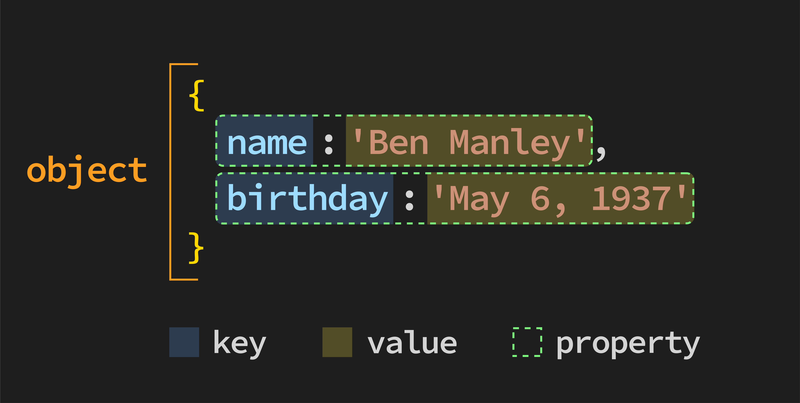

# Intro to JavaScript Objects - Concepts

**Learning objective:** By the end of this lesson, students will be able to define objects and their purpose.

## What are objects? 

Objects are the most common data structure in object-oriented programming. 

> 📚 Object-oriented programming (abbreviated as OOP) is a programming paradigm that focuses on organizing code around the concept of objects, which represent real-world entities or abstract concepts, encapsulating data and behavior within these objects.

Very simply, **objects** are a collection of zero or more **properties**.

So what’s a *property*? A *property* consists of a **`key: value`** pair, where the: 

- **key** is a *string* or *symbol* (other types will be coerced into strings), and the
- **value** is any JS expression (code that evaluates to a single value or thing), including other objects (yes, functions too - called **methods** when they are on an object).

In computer science, collections of key/value pairs are commonly referred to as dictionaries - a good visualization of what an object is.

> 📚 Objects are structured data types that hold related data (properties) and behavior (methods) within a single collection. 

> Properties are attributes associated with the object, which can store data of any data type, such as numbers, strings, or even other objects. Methods are functions associated with an object that define its behavior and can perform actions using the object's properties.

## Why use objects? 

As developers, you’ll be working with objects more than anything else. The following is just a small example of what is modeled using objects:

- The browser window and the elements it visualizes are all represented in memory as JS objects.
- Every part of those elements, including their styling, is accessed via JS objects.
- Data submitted from the browser will be accessed on the server as objects.
- Data retrieved from a database will be stored in objects.

In a process called *boxing*, even primitive data types like strings and numbers are turned into an object on demand by the JS runtime when we want to call a method like `toUpperCase`! So, now does it make sense why it’s called **object-oriented programming**?

> 💡 Unlike arrays, the order of properties in objects is not guaranteed. 